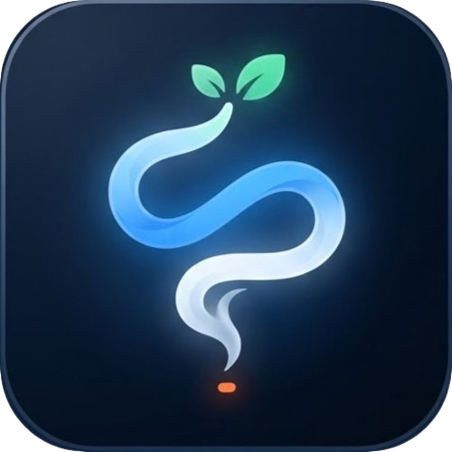
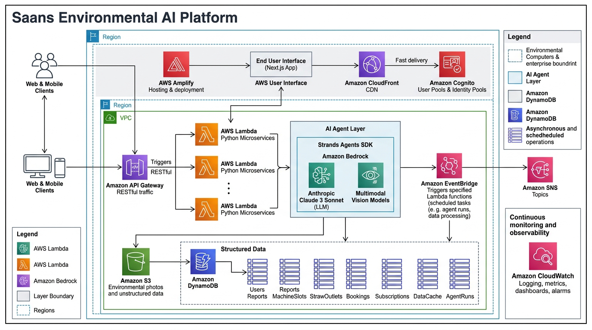

<p align="center">
  
</p>

<h1 align="center">Saans — "From Field to Delhi"</h1>

<p align="center">
  <strong>An agentic environmental platform bridging Punjab stubble management and Delhi NCR clean air action.</strong><br/>
  <a href="https://builder.aws.com/content/3KXlY4C8YUaNMtPlFRUQMGFZk5W/from-delhis-smog-to-aws-agents-building-saans">📝 <strong>Read AWS Builder Blog</strong></a> &nbsp;•&nbsp; 
  <a href="https://youtu.be/C0sCIiEWmRY">🎥 <strong>Watch Demo Video</strong></a>
</p>

<p align="center">
  
  
  
  
  
  
</p>

---

## 🌫️ Problem
Delhi NCR faces severe post-monsoon smog spikes (AQI 400+) triggered by crop residue burning during a critical 2–3 week harvest window. Farmers burn due to strict wheat sowing deadlines and machine scarcity, while downstream citizens suffer hazardous air quality with zero collaborative tools to bridge the regional divide.

## 💡 Solution
- **Burn-Window Planner for Farmers:** Analyzes wind vectors, rain forecasts, and sowing deadlines to determine optimal non-polluting field clearance dates with Punjabi/Hindi multilingual reasoning.
- **In-Situ Machine & Straw Outlets:** Books nearby Happy Seeders/mulchers and maps ex-situ biomass and CBG plants to keep stubble out of the air.
- **Shared AQI & Thermal Hotspot Map:** Unified MapLibre map visualizing NASA FIRMS satellite fire hotspots, Delhi CAAQMS station air quality, and farm depot inventories.
- **Citizen Observe & Report:** Allows NCR residents to report fire incidents with automated image verification via Amazon Bedrock Multimodal Vision.
- **Grounded GenAI Assistant ("Ask Saans"):** Answers farmer crop questions and citizen AQI health advisories grounded in cached environmental data.

---

## 🏗️ Architecture



- **Ingestion & Schedules:** Amazon EventBridge triggers scheduled Lambdas every 3 hours to ingest NASA FIRMS fire hotspots, Open-Meteo wind forecasts, and OpenAQ/CPCB station telemetry into DynamoDB (`saans-data-cache`).
- **Auth & Access:** Amazon Cognito User Pools handle role-based auth (`custom:role` = `farmer` | `citizen`) with secure SRP authentication and demo fallbacks.
- **APIs & Compute:** Amazon API Gateway throttles and routes requests to 11+ Python 3.12 AWS Lambda microservices for planning, bookings, and incident feeds.
- **GenAI Layer:** Amazon Bedrock (Claude 3 Sonnet & Multimodal Vision) powers report classification and multilingual farmer explanations, backed by deterministic scoring fallbacks.
- **Storage & Fanout:** Amazon DynamoDB powers 8 pay-per-request tables with TTLs/GSIs; Amazon S3 stores report photos with presigned URLs; Amazon SNS dispatches air quality notifications.

---

## 🛠️ Tech Stack

| Layer | Tools & AWS Services | Purpose |
| :--- | :--- | :--- |
| **Frontend** |    | PWA App Router, responsive dark mode, GSAP animations |
| **Geospatial** |  | Interactive map layers for wind vectors, FIRMS hotspots & AQI |
| **Compute & API** |   | Python 3.12 serverless microservices, REST endpoints, throttling |
| **AI & Vision** |  | Claude 3 Sonnet reasoning & Multimodal Vision report triage |
| **Data & Storage** |   | 8 on-demand DynamoDB tables with GSIs/TTL; S3 presigned photo bucket |
| **Security & Ops** |    | Role-based SRP auth, 3-hour cron ingestion, alert fanout |
| **Telemetry** | NASA FIRMS, Open-Meteo, OpenAQ / CPCB | Real satellite thermal anomalies, wind forecasts, Delhi CAAQMS AQI |

---

## 🚀 Quick Start

### 1. Setup & Installation
```bash
git clone https://github.com/Saaarthak0102/BharatBuilds.git
cd BharatBuilds/apps/web
npm install
```

### 2. Environment Configuration
Copy `.env.example` to `.env.local` (configured for AWS live backend with demo fallbacks; never commit secrets):
```bash
cp .env.example .env.local
```

### 3. Run Development Server
```bash
npm run dev
# Visit http://localhost:3000
```

### Key Local Routes
- `/` — Landing hero with one-click **Farmer / Citizen Demo Mode** switch
- `/farmer` & `/farmer/field` — Agricultural dashboard & 7-day burn-window planner
- `/farmer/book` & `/farmer/straw-outlets` — Machine slot booking & biomass facility locator
- `/citizen` & `/citizen/today` — Real-time air quality index, hourly trends & health advice
- `/citizen/report` — Image upload & Bedrock vision triage pipeline
- `/map` — Live interactive satellite fire and air quality map

---

## 📁 Project Structure

```
BharatBuilds/
├── apps/web/           # Next.js 16 frontend (TypeScript, Tailwind v4, MapLibre, GSAP)
│   ├── app/            # Routes: /farmer, /citizen, /map, /(auth)
│   ├── components/     # UI components & design system tokens
│   └── lib/            # AWS Cognito client, API integration, and mock fallback layer
├── services/           # Python 3.12 AWS Lambda microservices
│   ├── api/            # API Gateway handlers (farmer_plan, reports, ask, today)
│   ├── agents/         # Bedrock AI planners, report triage, and deterministic scorers
│   └── ingest/         # Ingestion workers (NASA FIRMS, Open-Meteo, OpenAQ/CPCB)
├── infra/              # AWS SAM Infrastructure as Code (template.yaml)
├── data/seed/          # Seed data (machine slots, straw outlets, villages, wards)
└── docs/               # Architecture diagrams and specifications
```

---

## 🏆 Submission & Author
- **Hackathon:** WeMakeDevs × AWS Environmental Hacks — **Air Track**
- **Author:** Sarthak Sabharwal — [GitHub](https://github.com/Saaarthak0102) • [LinkedIn](https://linkedin.com/in/saaarthak0102)

## 🗺️ Roadmap
- 📲 **SMS / WhatsApp Alerts:** Amazon SNS & Pinpoint integration for offline feature-phone advisory dispatch.
- 🚜 **IoT Fleet Telematics:** Real-time GPS tracking for cooperative Happy Seeder and baler deployments.
- 📡 **State Telemetry Integration:** Direct integration with Punjab PPCB & CAQM air monitor feeds.

## 📄 License
This project is licensed under the [MIT License](./LICENSE).
