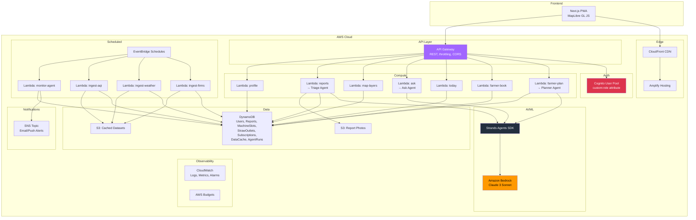
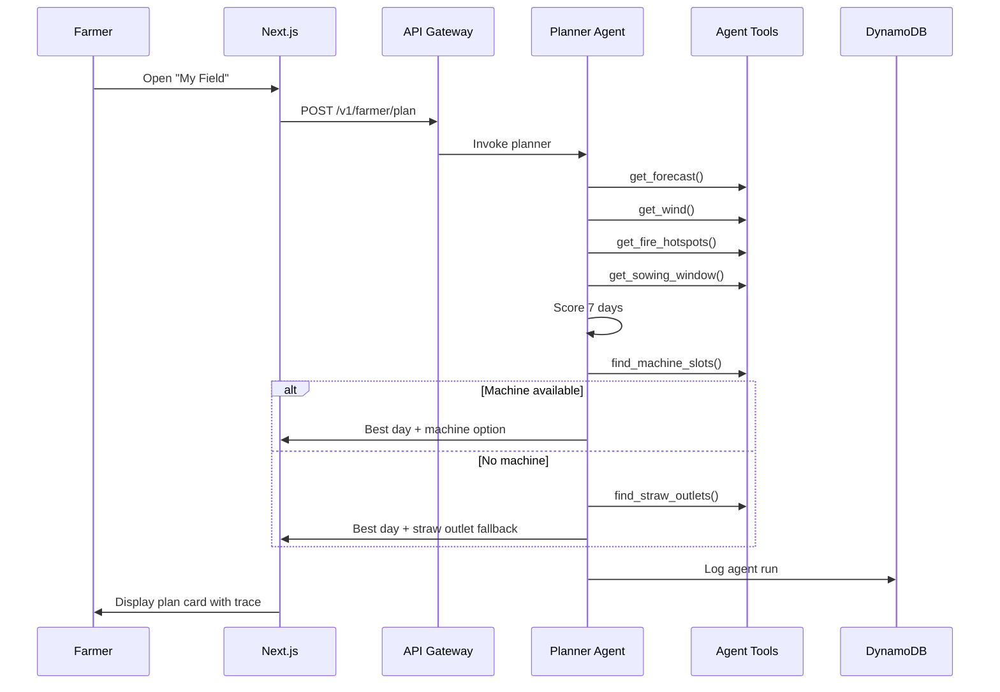

# Saans Architecture

## System Overview

## Data Flow

## Key Design Decisions

1. **Strands Agents SDK** for agent orchestration (satisfies AWS open-source requirement)
2. **Deterministic scoring** — the agent explains scores but doesn't override them
3. **Sample data badges** — all non-live data clearly marked in the UI
4. **Role-based auth** via Cognito `custom:role` — simple farmer/citizen separation
5. **No medical advice** — only standard AQI-category guidance
6. **Untrusted input handling** — report text never influences agent behavior
