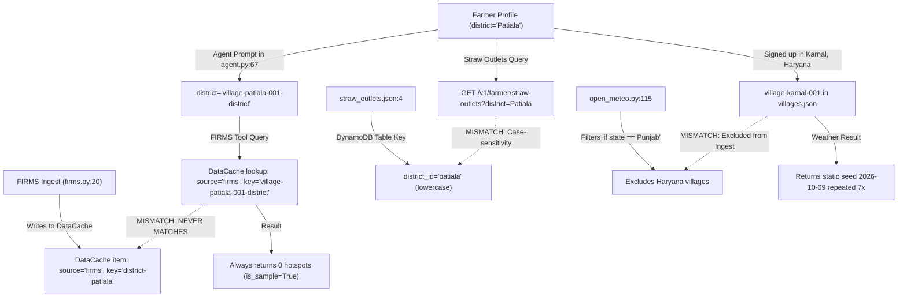
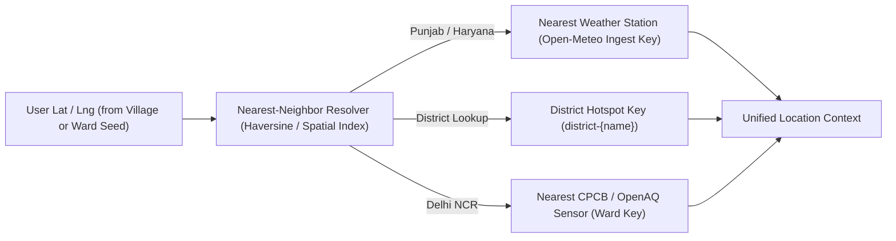
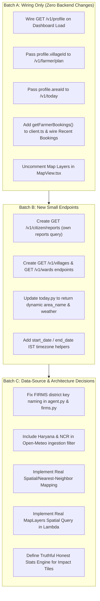

# Audit Report: Mock vs. Real Data across Saans Platform

> **Audit Status:** Complete Read-Only Architectural & Codebase Inspection  
> **Repository:** `Saaarthak0102/BharatBuilds` (`d:\BharatBuilds`)  
> **Timestamp:** 2026-10-11T13:10:00+05:30  
> **Scope:** Full trace across `apps/web` (Next.js), `services/` (Python AWS Lambda / Bedrock / DynamoDB), and `data/seed/`

---

## Executive Summary & Tile Counts

| Page / Surface | Total Displayed Elements / Tiles | Real API Backed | Mock / Hardcoded / Fallback | Gaps / Action Required |
| :--- | :---: | :---: | :---: | :--- |
| **Farmer Dashboard (`/farmer`)** | 22 | 1 (partial plan text/score) | 21 | High: ignores profile village; uses static mock weather, actions, bookings, and impact engine |
| **Citizen Dashboard (`/citizen`)** | 20 | 2 (AQI, advice) | 18 | High: ignores profile ward; uses static mock weather, collective impact, reports, and traces |
| **Farmer Field Planner (`/farmer/field`)** | 12 | 6 | 6 | Medium: dropdown uses mock village file; plan execution is real; fallback is local cache |
| **Farmer Machine Booking (`/farmer/book`)** | 10 | 6 | 4 | Medium: booking action is real, but hardcoded machine name and client-derived UTC dates |
| **Farmer Straw Outlets (`/farmer/straw-outlets`)** | 8 | 5 | 3 | Low: district query is real; district list hardcoded; facilities are sample data |
| **Citizen Today (`/citizen/today`)** | 14 | 8 | 6 | Medium: live AQI/trend; weather strip has hardcoded temp/condition/humidity/rain values |
| **Citizen Report (`/citizen/report`)** | 16 | 13 | 3 | Low: upload, Bedrock classify, DynamoDB submit & poll are real; ward picker uses mock file |
| **Live Map (`/map`)** | 8 | 0 | 8 | Critical: map overlays commented out (`false && ...`); backend `/v1/map/layers` returns hardcoded dict |
| **Profile Card / Modal (`ProfileCard`)** | 11 | 9 | 2 | Low: real `/v1/profile` retrieval; fallback is clean 404 state; health profile is local |
| **Landing Page Hero & Live Cards (`/`)** | 14 | 0 | 14 | High: phone mockup, "Best day to clear" and "142 AQI" are entirely hardcoded literals |
| **Total Platform Elements** | **135** | **48 (35.5%)** | **87 (64.5%)** | **64.5% of visible data is hardcoded or mock** |

---

## STEP 0: Mode and Environment Variables

### 1. Environment Variable Configuration

| Variable Name | Present in `.env.local` | Present in `.env.example` | Effective Value | Code Path Resolution |
| :--- | :---: | :---: | :---: | :--- |
| `NEXT_PUBLIC_AUTH_MODE` | **Yes** | **Yes** | `'cognito'` | `apps/web/lib/auth/authClient.ts:65`, `apps/web/lib/api/client.ts:19` |
| `NEXT_PUBLIC_USE_MOCKS` | **No** (unset) | **No** (unset) | `undefined` | `apps/web/lib/api/client.ts:15-18` |
| `NEXT_PUBLIC_API_MODE` | **No** (unset) | **Yes** (`real`) | `'mock'` (fallback) | `apps/web/lib/api/client.ts:10` (`process.env.NEXT_PUBLIC_API_MODE \|\| 'mock'`) |
| `NEXT_PUBLIC_API_URL` | **Yes** | **Yes** | Set (Deployed AWS API Gateway URL) | `apps/web/lib/api/client.ts:11`, `apps/web/lib/auth/cognitoAuth.ts:233` |

> *Security Notice:* Secrets, access keys, and user pool sensitive strings are intentionally not printed.

### 2. Evaluation of `isMockMode` in `apps/web/lib/api/client.ts`

```typescript
// apps/web/lib/api/client.ts:14-21
export const isMockMode =
  process.env.NEXT_PUBLIC_USE_MOCKS === 'true'
    ? true
    : process.env.NEXT_PUBLIC_USE_MOCKS === 'false'
    ? false
    : process.env.NEXT_PUBLIC_AUTH_MODE === 'cognito'
    ? false
    : API_MODE === 'mock';
```

- Condition 1: `process.env.NEXT_PUBLIC_USE_MOCKS === 'true'` &rarr; `false` (undefined).
- Condition 2: `process.env.NEXT_PUBLIC_USE_MOCKS === 'false'` &rarr; `false` (undefined).
- Condition 3: `process.env.NEXT_PUBLIC_AUTH_MODE === 'cognito'` &rarr; **`true`** (explicitly set in `.env.local:2`).
- **Result:** `isMockMode` evaluates to **`false`**. The application is configured to execute real network requests to the AWS backend.

### 3. Comprehensive Method Audit for `lib/api/client.ts`

| Client Function | Real Network Branch? | Endpoint Invoked | Calling Components / Pages |
| :--- | :---: | :--- | :--- |
| `getUploadUrl` | **Yes** (`fetchWithAuth`) | `POST /v1/reports/upload-url` | [report/page.tsx:11](file:///d:/BharatBuilds/apps/web/app/citizen/report/page.tsx#L11) |
| `uploadPhoto` | **Yes** (`fetch(uploadUrl, PUT)`) | S3 Presigned URL | [report/page.tsx:12](file:///d:/BharatBuilds/apps/web/app/citizen/report/page.tsx#L12) |
| `classifyPhoto` | **Yes** (`fetchWithAuth`) | `POST /v1/reports/classify` | [report/page.tsx:13](file:///d:/BharatBuilds/apps/web/app/citizen/report/page.tsx#L13) |
| `submitReport` | **Yes** (`fetchWithAuth`) | `POST /v1/reports` | [report/page.tsx:14](file:///d:/BharatBuilds/apps/web/app/citizen/report/page.tsx#L14) |
| `getReport` | **Yes** (`fetchWithAuth`) | `GET /v1/reports/{report_id}` | [report/page.tsx:15](file:///d:/BharatBuilds/apps/web/app/citizen/report/page.tsx#L15) |
| `getToday` | **Yes** (`fetchWithAuth`) | `GET /v1/today?area=...` | [today/page.tsx:10](file:///d:/BharatBuilds/apps/web/app/citizen/today/page.tsx#L10), [citizen/page.tsx:64](file:///d:/BharatBuilds/apps/web/app/citizen/page.tsx#L64) (via `apiClient.citizen.today`) |
| `getProfile` | **Yes** (`fetchWithAuth`) | `GET /v1/profile` | [ProfileCard.tsx:8](file:///d:/BharatBuilds/apps/web/components/dashboard/ProfileCard.tsx#L8), [ProfileMenu.tsx:7](file:///d:/BharatBuilds/apps/web/components/dashboard/ProfileMenu.tsx#L7), [today/page.tsx:10](file:///d:/BharatBuilds/apps/web/app/citizen/today/page.tsx#L10), `straw-outlets`, `field`, `book` |
| `apiClient.farmer.plan` | **Yes** (`fetchWithAuth`) | `POST /v1/farmer/plan` | [farmer/page.tsx:49](file:///d:/BharatBuilds/apps/web/app/farmer/page.tsx#L49), [field/page.tsx:69](file:///d:/BharatBuilds/apps/web/app/farmer/field/page.tsx#L69), [book/page.tsx:67](file:///d:/BharatBuilds/apps/web/app/farmer/book/page.tsx#L67) |
| `apiClient.farmer.book` | **Yes** (`fetchWithAuth`) | `POST /v1/farmer/book` | [book/page.tsx:90](file:///d:/BharatBuilds/apps/web/app/farmer/book/page.tsx#L90) |
| `apiClient.farmer.strawOutlets` | **Yes** (`fetchWithAuth`) | `GET /v1/farmer/straw-outlets?district=...` | [straw-outlets/page.tsx:62](file:///d:/BharatBuilds/apps/web/app/farmer/straw-outlets/page.tsx#L62) |
| `apiClient.farmer.getProfile` | **Yes** (delegates) | `GET /v1/profile` | [field/page.tsx:39](file:///d:/BharatBuilds/apps/web/app/farmer/field/page.tsx#L39), [book/page.tsx:42](file:///d:/BharatBuilds/apps/web/app/farmer/book/page.tsx#L42), [straw-outlets/page.tsx:44](file:///d:/BharatBuilds/apps/web/app/farmer/straw-outlets/page.tsx#L44) |
| `apiClient.citizen.today` | **Yes** (delegates) | `GET /v1/today?area=...` | [citizen/page.tsx:64](file:///d:/BharatBuilds/apps/web/app/citizen/page.tsx#L64) |
| `apiClient.citizen.ask` | **Yes** (`fetchWithAuth`) | `POST /v1/ask` | **NONE** (Never invoked by any UI component) |
| `apiClient.citizen.getProfile` | **Yes** (delegates) | `GET /v1/profile` | (Available, callers use standalone `getProfile`) |
| `apiClient.map.layers` | **Yes** (`fetchWithAuth`) | `GET /v1/map/layers` | [map/page.tsx:19](file:///d:/BharatBuilds/apps/web/app/map/page.tsx#L19) |
| `apiClient.reports.get` | **Yes** (`fetchWithAuth`) | `GET /v1/reports` | **NONE** (Never invoked by any UI component) |

---

## STEP 1: Tile-by-Tile Audit for Dashboards

### Farmer Dashboard (`apps/web/app/farmer/page.tsx` & Child Components)

| Element / Tile | File & Line | Current Source | Real API Available Today? | What Real Value It Should Show | Architectural Gap | Sample Badge Driven by API? |
| :--- | :--- | :--- | :--- | :--- | :--- | :--- |
| **Page Title** ("My Field") | [app/farmer/page.tsx:83](file:///d:/BharatBuilds/apps/web/app/farmer/page.tsx#L83), [:193](file:///d:/BharatBuilds/apps/web/app/farmer/page.tsx#L193) | i18n (`farmer.myField`) | None (UI label) | Localized title string | none | N/A |
| **Place Name & Date Line** ("Patiala, Punjab · Tuesday, Nov 5") | [app/farmer/page.tsx:194-195](file:///d:/BharatBuilds/apps/web/app/farmer/page.tsx#L194-L195) | `t('farmer.location')` hardcoded in `en.ts:48`; date literal string `"Tuesday, Nov 5"` | Yes (`GET /v1/profile` + client date) | `"${profile.villageName}, ${profile.district}"` + Today's date in `Asia/Kolkata` | needs wiring | No (hardcoded string) |
| **Weather Temp** (`26°`) | [lib/mock/dashboardData.ts:256](file:///d:/BharatBuilds/apps/web/lib/mock/dashboardData.ts#L256) via [WeatherPanel.tsx:89](file:///d:/BharatBuilds/apps/web/components/dashboard/WeatherPanel.tsx#L89) | `FULL_WEATHER_FARMER.temp` | Yes (cached from Open-Meteo in `DataCacheTable`) | Current ambient temperature from Open-Meteo ingest for user's village | needs NEW endpoint (e.g. `GET /v1/weather/current`) or summary | Yes (`plan?.is_sample ?? true` passed to panel) |
| **Condition & Icon** ("Clear Sky", sun) | [lib/mock/dashboardData.ts:260-261](file:///d:/BharatBuilds/apps/web/lib/mock/dashboardData.ts#L260-L261) via [WeatherPanel.tsx:86-93](file:///d:/BharatBuilds/apps/web/components/dashboard/WeatherPanel.tsx#L86-L93) | `FULL_WEATHER_FARMER.condition` | Yes (Open-Meteo WMO code in `DataCacheTable`) | Real condition mapped from WMO code for user's village | needs NEW endpoint | Yes |
| **Feels Like** (`27°`) | [lib/mock/dashboardData.ts:257](file:///d:/BharatBuilds/apps/web/lib/mock/dashboardData.ts#L257) via [WeatherPanel.tsx:94](file:///d:/BharatBuilds/apps/web/components/dashboard/WeatherPanel.tsx#L94) | `FULL_WEATHER_FARMER.feelsLike` | Yes (Open-Meteo apparent temperature) | Apparent temp from Open-Meteo | needs NEW endpoint | Yes |
| **High / Low Temp** (`29°` / `17°`) | [lib/mock/dashboardData.ts:258-259](file:///d:/BharatBuilds/apps/web/lib/mock/dashboardData.ts#L258-L259) via [WeatherPanel.tsx:99-100](file:///d:/BharatBuilds/apps/web/components/dashboard/WeatherPanel.tsx#L99-L100) | `FULL_WEATHER_FARMER.high` / `.low` | Yes (Open-Meteo `temperature_2m_max/min` in `DataCacheTable`) | Daily max/min from Open-Meteo | needs NEW endpoint | Yes |
| **AQI Chip & Category** (`AQI 142 (Moderate)`) | [lib/mock/dashboardData.ts:269-270](file:///d:/BharatBuilds/apps/web/lib/mock/dashboardData.ts#L269-L270) via [WeatherPanel.tsx:106](file:///d:/BharatBuilds/apps/web/components/dashboard/WeatherPanel.tsx#L106) | `FULL_WEATHER_FARMER.aqi` / `.aqiLabel` | Yes (`GET /v1/today` or `DataCacheTable` source `aqi`) | Regional CPCB/OpenAQ reading for user's district | needs wiring (`GET /v1/today`) | Yes |
| **Wind Speed & Dir** (`9 km/h NW`) | [lib/mock/dashboardData.ts:262-263](file:///d:/BharatBuilds/apps/web/lib/mock/dashboardData.ts#L262-L263) via [WeatherPanel.tsx:116](file:///d:/BharatBuilds/apps/web/components/dashboard/WeatherPanel.tsx#L116) | `FULL_WEATHER_FARMER.windSpeed` / `.windDir` | Yes (Open-Meteo `wind_speed_10m_max` in `DataCacheTable`) | Ingested wind vector for user's village | needs NEW endpoint | Yes |
| **Humidity** (`42%`) | [lib/mock/dashboardData.ts:264](file:///d:/BharatBuilds/apps/web/lib/mock/dashboardData.ts#L264) via [WeatherPanel.tsx:120](file:///d:/BharatBuilds/apps/web/components/dashboard/WeatherPanel.tsx#L120) | `FULL_WEATHER_FARMER.humidity` | Yes (Open-Meteo relative humidity) | Ingested humidity | needs NEW endpoint | Yes |
| **Rain Chance** (`0%`) | [lib/mock/dashboardData.ts:265](file:///d:/BharatBuilds/apps/web/lib/mock/dashboardData.ts#L265) via [WeatherPanel.tsx:124](file:///d:/BharatBuilds/apps/web/components/dashboard/WeatherPanel.tsx#L124) | `FULL_WEATHER_FARMER.rainChance` | Yes (Open-Meteo `precipitation_probability_max`) | Ingested precipitation probability | needs NEW endpoint | Yes |
| **Visibility** (`8 km`) | [lib/mock/dashboardData.ts:266](file:///d:/BharatBuilds/apps/web/lib/mock/dashboardData.ts#L266) via [WeatherPanel.tsx:128](file:///d:/BharatBuilds/apps/web/components/dashboard/WeatherPanel.tsx#L128) | `FULL_WEATHER_FARMER.visibility` | No (Open-Meteo standard forecast does not ingest visibility) | Open-Meteo or CPCB visibility sensor | needs NEW data source | Yes |
| **UV Index** (`6`) | [lib/mock/dashboardData.ts:267](file:///d:/BharatBuilds/apps/web/lib/mock/dashboardData.ts#L267) via [WeatherPanel.tsx:132](file:///d:/BharatBuilds/apps/web/components/dashboard/WeatherPanel.tsx#L132) | `FULL_WEATHER_FARMER.uvIndex` | Yes (Open-Meteo provides `uv_index_max`) | Open-Meteo UV index | needs NEW data source (expand Open-Meteo ingest params) | Yes |
| **Sunset Time** (`5:42 PM`) | [lib/mock/dashboardData.ts:268](file:///d:/BharatBuilds/apps/web/lib/mock/dashboardData.ts#L268) via [WeatherPanel.tsx:136](file:///d:/BharatBuilds/apps/web/components/dashboard/WeatherPanel.tsx#L136) | `FULL_WEATHER_FARMER.sunset` | Yes (Open-Meteo provides `sunset` timestamp in `Asia/Kolkata`) | Real sunset time for coordinate | needs NEW data source (expand Open-Meteo ingest params) | Yes |
| **BEST CLEARING DAY Date & Score** | [app/farmer/page.tsx:207-217](file:///d:/BharatBuilds/apps/web/app/farmer/page.tsx#L207-L217) | `plan?.best_day` (defaults to `"Score 82/100"`, `"Tuesday, Nov 5"`) | Yes (`POST /v1/farmer/plan`) | Date and score computed for *the user's saved village*, not hardcoded `village-patiala-001` | needs wiring (pass `profile.villageId`) | Yes (`plan?.is_sample`) |
| **Reason Explanation Text** | [app/farmer/page.tsx:220-223](file:///d:/BharatBuilds/apps/web/app/farmer/page.tsx#L220-L223) | `plan?.reason_text` (fallback literal string) | Yes (`POST /v1/farmer/plan`) | Bedrock-generated explanation | needs wiring | Yes |
| **Machine Availability MiniStat** | [app/farmer/page.tsx:233-234](file:///d:/BharatBuilds/apps/web/app/farmer/page.tsx#L233-L234) | Hardcoded strings `"Happy Seeder"`, `"Kisan Seva Kendra, Patiala"` | Yes (`plan?.machine_option` from `/v1/farmer/plan`) | `plan.machine_option.machine_type` & `.owner_label` (or "No machine available") | needs wiring | No badge present |
| **Earnings MiniStat** (`₹29,600`) | [app/farmer/page.tsx:242](file:///d:/BharatBuilds/apps/web/app/farmer/page.tsx#L242) via `calculateEarnings()` | Sum of 3 hardcoded actions in `lib/mock/dashboardData.ts:70-95` | No | Derived total from user's completed bookings (`completed_bookings * acres * ₹1,000`) | needs NEW endpoint (derived user impact summary) | Hardcoded (no badge) |
| **Burning Avoided MiniStat** (`14 acres`) | [app/farmer/page.tsx:251](file:///d:/BharatBuilds/apps/web/app/farmer/page.tsx#L251) via `calculateFarmerImpact()` | Hardcoded math formula in `lib/mock/dashboardData.ts:130` (`totalAcres + 9`) | No | Sum of user's own cleared acres without burning | needs NEW endpoint | Hardcoded (no badge) |
| **Environment Saved MiniStat** (`201 kg PM2.5`, `45 t CO2`) | [app/farmer/page.tsx:261-262](file:///d:/BharatBuilds/apps/web/app/farmer/page.tsx#L261-L262) via `calculateFarmerImpact()` | Constant-factor multipliers in `lib/mock/dashboardData.ts:133-134` | No | Calculated emission reduction based on user's cleared acres (`acres * 2.2 * 6.5kg PM2.5`) | needs NEW endpoint | Hardcoded badge `"est."` |
| **ActionCard "Next Available" Row** | [app/farmer/page.tsx:294-295](file:///d:/BharatBuilds/apps/web/app/farmer/page.tsx#L294-L295) | Hardcoded strings `"Happy Seeder"`, `"Kisan Seva Kendra (4 km) • Tomorrow, 9 AM"` | Yes (`plan.machine_option`) | Closest available machine slot from `POST /v1/farmer/plan` | needs wiring | No |
| **Bookings Counters Chips** (`Bookings: 8`, `Completed: 7`, `Upcoming: 1`) | [app/farmer/page.tsx:305-307](file:///d:/BharatBuilds/apps/web/app/farmer/page.tsx#L305-L307) | Hardcoded literal strings in JSX | Yes (`GET /v1/farmer/bookings` exists in Lambda!) | Real counts computed from caller's bookings in DynamoDB `BookingsTable` | needs wiring (`GET /v1/farmer/bookings`) | No |
| **Recent Bookings List Rows** | [app/farmer/page.tsx:313](file:///d:/BharatBuilds/apps/web/app/farmer/page.tsx#L313) via `bookingListItems` | `MOCK_RECENT_BOOKINGS` in `lib/mock/dashboardData.ts:319-341` | Yes (`GET /v1/farmer/bookings`) | User's actual items from `GET /v1/farmer/bookings` | needs wiring (`GET /v1/farmer/bookings`) | No |
| **Straw Outlets Tile Sublabel** ("Patiala Hub") | [app/farmer/page.tsx:328](file:///d:/BharatBuilds/apps/web/app/farmer/page.tsx#L328) | Hardcoded string `"Patiala Hub"` | Yes (`GET /v1/profile`) | User's profile district hub (`"${profile.district} Hub"`) | needs wiring | No |
| **Planner Tile Sublabel** ("Next 7 Days") | [app/farmer/page.tsx:337](file:///d:/BharatBuilds/apps/web/app/farmer/page.tsx#L337) | Hardcoded string `"Next 7 Days"` | None (UI label) | Static UI label is appropriate | none | No |

---

### Citizen Dashboard (`apps/web/app/citizen/page.tsx` & Child Components)

| Element / Tile | File & Line | Current Source | Real API Available Today? | What Real Value It Should Show | Architectural Gap | Sample Badge Driven by API? |
| :--- | :--- | :--- | :--- | :--- | :--- | :--- |
| **Page Title** ("Today's Air") | [app/citizen/page.tsx:130](file:///d:/BharatBuilds/apps/web/app/citizen/page.tsx#L130), [:262](file:///d:/BharatBuilds/apps/web/app/citizen/page.tsx#L262) | i18n (`citizen.today`) | None (UI label) | Localized title string | none | N/A |
| **Area Badge & Date Line** ("East Delhi · Today, 10:15 AM") | [app/citizen/page.tsx:145](file:///d:/BharatBuilds/apps/web/app/citizen/page.tsx#L145), [:263-264](file:///d:/BharatBuilds/apps/web/app/citizen/page.tsx#L263-L264) | Mobile Chip hardcoded `"East Delhi"`; Desktop `t('citizen.location')` (`en.ts:75`); date literal `"Today, 10:15 AM"` | Yes (`GET /v1/profile` + client timestamp) | User's saved `profile.areaName` + Current local time | needs wiring | No (hardcoded string) |
| **Weather Panel** (Temp `24°`, Hazy, Wind `12 NW`, Rain `0%`, etc.) | [app/citizen/page.tsx:261](file:///d:/BharatBuilds/apps/web/app/citizen/page.tsx#L261) via [WeatherPanel.tsx](file:///d:/BharatBuilds/apps/web/components/dashboard/WeatherPanel.tsx) | `FULL_WEATHER_CITIZEN` in `lib/mock/dashboardData.ts:281-305` | Yes (partially in `GET /v1/today` wind object; remainder in `DataCacheTable`) | Real meteorological conditions from Open-Meteo for caller's ward | needs NEW endpoint (e.g. merge full weather into `/v1/today`) | Yes (`today?.is_sample ?? true`) |
| **AQI Ring & Category** (`185`, `POOR`) | [app/citizen/page.tsx:157-163](file:///d:/BharatBuilds/apps/web/app/citizen/page.tsx#L157-L163), [:281-288](file:///d:/BharatBuilds/apps/web/app/citizen/page.tsx#L281-L288) | `today?.aqi` & `today?.aqi_category` (queried with hardcoded `'ward-east-delhi-001'`) | Yes (`GET /v1/today?area=...`) | Live CPCB/OpenAQ reading for *the user's saved ward* | needs wiring (query `profile.areaId`) | Yes (`today?.is_sample`) |
| **Health Advice Text** | [app/citizen/page.tsx:167](file:///d:/BharatBuilds/apps/web/app/citizen/page.tsx#L167), [:298-300](file:///d:/BharatBuilds/apps/web/app/citizen/page.tsx#L298-L300) | `today?.advice` from API (fallback literal) | Yes (`GET /v1/today`) | CPCB official category health guidance from `services/api/handlers/today.py:23-30` | needs wiring (use profile ward) | Yes |
| **Advice Footnote** ("NW wind 12 km/h • Residual agricultural smoke...") | [app/citizen/page.tsx:302-305](file:///d:/BharatBuilds/apps/web/app/citizen/page.tsx#L302-L305) | Hardcoded literal strings in JSX | Yes (`today.wind` & `today.smoke_drift_note`) | Dynamic strings from API response (`${today.wind.direction} ${today.wind.speed_kmh} km/h • ${today.smoke_drift_note}`) | needs wiring | Yes |
| **Burning Stopped Today** (`142 fields`, `687 t stubble`) | [app/citizen/page.tsx:316-317](file:///d:/BharatBuilds/apps/web/app/citizen/page.tsx#L316-L317) via `getCitizenRegionalImpact()` | Hardcoded math constant `fieldsToday = 142` in `lib/mock/dashboardData.ts:159` | No | Aggregated count of confirmed mechanized bookings across NCR border today | needs NEW endpoint (e.g. `GET /v1/impact/aggregate`) | Hardcoded (no badge) |
| **Saved Today** (`4,465 kg PM2.5`, `1,003 t CO2`) | [app/citizen/page.tsx:326-327](file:///d:/BharatBuilds/apps/web/app/citizen/page.tsx#L326-L327) via `getCitizenRegionalImpact()` | Hardcoded formula in `lib/mock/dashboardData.ts:163-164` | No | Derived total from confirmed collective machine actions | needs NEW endpoint | Hardcoded badge `"est."` |
| **Did You Know? Fact Carousel** | [app/citizen/page.tsx:346](file:///d:/BharatBuilds/apps/web/app/citizen/page.tsx#L346) | `DID_YOU_KNOW_FACTS` array in `lib/mock/dashboardData.ts:179-187` | None | Curated educational facts; client static rotation is acceptable | none (educational content) | No |
| **Best Time Outside** ("1:30 PM – 4:00 PM", "Cleanest window...") | [app/citizen/page.tsx:359-360](file:///d:/BharatBuilds/apps/web/app/citizen/page.tsx#L359-L360) | Hardcoded strings `"1:30 PM – 4:00 PM"`, `"Cleanest daylight window (AQI ~140)"` | Yes (can be calculated from 24h hourly forecast in `DataCacheTable`) | Time window with lowest predicted AQI / solar dispersal | needs NEW endpoint (derived from hourly forecast) | Hardcoded (no badge) |
| **Report Status Chips** (`Reports: 3`, `Verified: 2`, `Action taken: 1`) | [app/citizen/page.tsx:394-396](file:///d:/BharatBuilds/apps/web/app/citizen/page.tsx#L394-L396) | Hardcoded literal strings in JSX | No (no endpoint to query user's own reports) | Real counts of caller's submitted reports grouped by status | needs NEW endpoint (`GET /v1/citizen/reports`) | No |
| **Recent Reports List Rows** | [app/citizen/page.tsx:402](file:///d:/BharatBuilds/apps/web/app/citizen/page.tsx#L402) via `reportListItems` | `MOCK_RECENT_REPORTS` in `lib/mock/dashboardData.ts:352-374` | No | Real list of caller's own submitted reports | needs NEW endpoint (`GET /v1/citizen/reports`) | No |
| **Map View Sublabel** ("Delhi NCR & Fires") | [app/citizen/page.tsx:416](file:///d:/BharatBuilds/apps/web/app/citizen/page.tsx#L416) | Hardcoded string `"Delhi NCR & Fires"` | None (UI label) | Static UI label is acceptable | none | No |
| **Alert Settings Sublabel** ("Threshold 200 AQI") | [app/citizen/page.tsx:423](file:///d:/BharatBuilds/apps/web/app/citizen/page.tsx#L423) | Hardcoded string `"Threshold 200 AQI"` | Yes (`GET /v1/profile`) | `profile.alertThreshold ? "Threshold ${profile.alertThreshold} AQI" : "Alerts disabled"` | needs wiring | No |
| **Citizen Tool Traces Accordion** | [app/citizen/page.tsx:51-56](file:///d:/BharatBuilds/apps/web/app/citizen/page.tsx#L51-L56), [:468](file:///d:/BharatBuilds/apps/web/app/citizen/page.tsx#L468) | Hardcoded array of 4 synthetic tools (`get_current_aqi`, `get_cpcb_station_data`, etc.) | Yes (`AgentRunsTable` exists in DynamoDB!) | Real tool trace array returned from backend ingest or today calculation | needs NEW endpoint (or include traces in `/v1/today` response) | No |
| **Mobile Wind & Forecast Card** | [app/citizen/page.tsx:179-181](file:///d:/BharatBuilds/apps/web/app/citizen/page.tsx#L179-L181) | Hardcoded literal paragraph: `"Winds are currently blowing from the northwest at 12km/h..."` | Yes (`today.wind` & `today.smoke_drift_note`) | Dynamic sentence generated from `today.wind` | needs wiring | No |

---

## STEP 2: Every Other Page Audit

### 1. Farmer Field Planner (`apps/web/app/farmer/field/page.tsx`)

| Element | File & Line | Current Source | Real API Available? | Real Value Desired | Gap | Sample Badge? |
| :--- | :--- | :--- | :--- | :--- | :--- | :--- |
| **Village Dropdown Options** | [app/farmer/field/page.tsx:122-124](file:///d:/BharatBuilds/apps/web/app/farmer/field/page.tsx#L122-L124) | `mockVillages` in `lib/mock/villages.ts` (only 4 villages!) | No public village list endpoint | Complete list of all 8 villages in `data/seed/villages.json` | needs NEW endpoint (`GET /v1/villages`) | No |
| **Preselected Village & Stage** | [app/farmer/field/page.tsx:39-42](file:///d:/BharatBuilds/apps/web/app/farmer/field/page.tsx#L39-L42) | Real `apiClient.farmer.getProfile()` | Yes (`GET /v1/profile`) | Correctly wired from caller's profile | none | No |
| **Plan Execution** | [app/farmer/field/page.tsx:69-73](file:///d:/BharatBuilds/apps/web/app/farmer/field/page.tsx#L69-L73) | Real `apiClient.farmer.plan()` | Yes (`POST /v1/farmer/plan`) | Plan result from Strands agent | none | Yes (`planResult.is_sample`) |
| **Offline Cache Fallback** | [app/farmer/field/page.tsx:75-85](file:///d:/BharatBuilds/apps/web/app/farmer/field/page.tsx#L75-L85) | `localStorage.getItem('lastPlanResult')` | Client Cache | Cached last successful result | none | Yes (shows `LAST RESULT (OFFLINE)`) |

---

### 2. Farmer Machine Booking (`apps/web/app/farmer/book/page.tsx`)

| Element | File & Line | Current Source | Real API Available? | Real Value Desired | Gap | Sample Badge? |
| :--- | :--- | :--- | :--- | :--- | :--- | :--- |
| **Earliest / Latest Date Inputs** | [app/farmer/book/page.tsx:45-51](file:///d:/BharatBuilds/apps/web/app/farmer/book/page.tsx#L45-L51) | Client `new Date()` +1 day and +7 days | Local Client State | Next 7-day window formatted in `Asia/Kolkata` | needs timezone fix (client uses UTC `toISOString()`) | No |
| **Direct URL Booking Machine Name** | [app/farmer/book/page.tsx:189](file:///d:/BharatBuilds/apps/web/app/farmer/book/page.tsx#L189) | Hardcoded literal `"Happy Seeder"` | Yes (from `plan.machine_option`) | Should pass machine name in query param or lookup slot | needs wiring | No |
| **Direct URL Booking Rate** | [app/farmer/book/page.tsx:332](file:///d:/BharatBuilds/apps/web/app/farmer/book/page.tsx#L332) | Hardcoded literal `"Standard rates"` | No (machine slots don't store prices) | Stored standard rate (e.g. `₹1,000/acre`) | needs data field on MachineSlots | No |
| **Booking Execution** | [app/farmer/book/page.tsx:90-95](file:///d:/BharatBuilds/apps/web/app/farmer/book/page.tsx#L90-L95) | Real `apiClient.farmer.book()` | Yes (`POST /v1/farmer/book`) | DynamoDB transactional write & slot decrement | none | Yes (`res.data.is_sample`) |

---

### 3. Farmer Straw Outlets (`apps/web/app/farmer/straw-outlets/page.tsx`)

| Element | File & Line | Current Source | Real API Available? | Real Value Desired | Gap | Sample Badge? |
| :--- | :--- | :--- | :--- | :--- | :--- | :--- |
| **District Dropdown Options** | [app/farmer/straw-outlets/page.tsx:12-17](file:///d:/BharatBuilds/apps/web/app/farmer/straw-outlets/page.tsx#L12-L17) | Hardcoded array (Patiala, Ludhiana, Sangrur, Moga) | No district list endpoint | Dynamic district list matching seeded outlets | needs NEW endpoint | No |
| **Preselected District** | [app/farmer/straw-outlets/page.tsx:46-51](file:///d:/BharatBuilds/apps/web/app/farmer/straw-outlets/page.tsx#L46-L51) | Real `apiClient.farmer.getProfile()` | Yes (`GET /v1/profile`) | Correctly wired from caller's district | none | No |
| **Straw Outlets Retrieval** | [app/farmer/straw-outlets/page.tsx:62](file:///d:/BharatBuilds/apps/web/app/farmer/straw-outlets/page.tsx#L62) | Real `apiClient.farmer.strawOutlets()` | Yes (`GET /v1/farmer/straw-outlets?district=...`) | Reads `StrawOutletsTable` in DynamoDB | none | Yes (all outlets tagged `is_sample: true`) |

---

### 4. Citizen Today Air Quality (`apps/web/app/citizen/today/page.tsx`)

| Element | File & Line | Current Source | Real API Available? | Real Value Desired | Gap | Sample Badge? |
| :--- | :--- | :--- | :--- | :--- | :--- | :--- |
| **Ward Picker Options** | [app/citizen/today/page.tsx:224](file:///d:/BharatBuilds/apps/web/app/citizen/today/page.tsx#L224) | `mockWards` in `lib/mock/wards.ts` (only 4 wards!) | No ward endpoint | Full list of all 7 wards from `data/seed/wards.json` | needs NEW endpoint (`GET /v1/wards`) | No |
| **Default Ward Selection** | [app/citizen/today/page.tsx:100-103](file:///d:/BharatBuilds/apps/web/app/citizen/today/page.tsx#L100-L103) | Real `getProfile()` | Yes (`GET /v1/profile`) | Uses `profile.area_id` if present | none | No |
| **AQI Ring, Category, Advice** | [app/citizen/today/page.tsx:317-340](file:///d:/BharatBuilds/apps/web/app/citizen/today/page.tsx#L317-L340) | Real `getToday(areaId)` | Yes (`GET /v1/today`) | Live reading & official advice | none | Yes (`today.is_sample`) |
| **WeatherStrip Temperature** | [app/citizen/today/page.tsx:187](file:///d:/BharatBuilds/apps/web/app/citizen/today/page.tsx#L187) | Hardcoded literal `'24°C'` | Yes (`DataCacheTable` source `open_meteo`) | Ingested temperature for the ward | needs wiring (include temp in `/v1/today` payload) | Yes |
| **WeatherStrip Condition** | [app/citizen/today/page.tsx:188](file:///d:/BharatBuilds/apps/web/app/citizen/today/page.tsx#L188) | Hardcoded literal `'Residual Smoke'` | Yes (`DataCacheTable` source `open_meteo`) | Ingested weather condition | needs wiring | Yes |
| **WeatherStrip Humidity & Rain** | [app/citizen/today/page.tsx:192-193](file:///d:/BharatBuilds/apps/web/app/citizen/today/page.tsx#L192-L193) | Hardcoded literals `'58%'`, `'10%'` | Yes (`DataCacheTable` source `open_meteo`) | Ingested humidity & precip probability | needs wiring | Yes |
| **24h AQI Trend Strip** | [app/citizen/today/page.tsx:364-392](file:///d:/BharatBuilds/apps/web/app/citizen/today/page.tsx#L364-L392) | `today.trend_24h` from API | Yes (`GET /v1/today`) | Real or seeded 24h trend points | none | Yes |

---

### 5. Citizen Report Flow (`apps/web/app/citizen/report/page.tsx`)

| Element | File & Line | Current Source | Real API Available? | Real Value Desired | Gap | Sample Badge? |
| :--- | :--- | :--- | :--- | :--- | :--- | :--- |
| **GPS Auto-tagging** | [app/citizen/report/page.tsx:96-109](file:///d:/BharatBuilds/apps/web/app/citizen/report/page.tsx#L96-L109) | Browser `navigator.geolocation` | Browser Geolocation API | User's real GPS latitude/longitude | none | No |
| **Manual Ward Selection** | [app/citizen/report/page.tsx:69](file:///d:/BharatBuilds/apps/web/app/citizen/report/page.tsx#L69) | `mockWards` in `lib/mock/wards.ts` | No ward endpoint | Full wards list from `data/seed/wards.json` | needs NEW endpoint | No |
| **S3 Presigned Photo Upload** | [app/citizen/report/page.tsx:273-285](file:///d:/BharatBuilds/apps/web/app/citizen/report/page.tsx#L273-L285) | Real `getUploadUrl` + `uploadPhoto` | Yes (`POST /v1/reports/upload-url`) | Real direct-to-S3 PUT upload | none | No |
| **Bedrock Photo Classification** | [app/citizen/report/page.tsx:288-292](file:///d:/BharatBuilds/apps/web/app/citizen/report/page.tsx#L288-L292) | Real `classifyPhoto` | Yes (`POST /v1/reports/classify`) | Amazon Bedrock vision model classification | none | No |
| **Report Submission** | [app/citizen/report/page.tsx:294-301](file:///d:/BharatBuilds/apps/web/app/citizen/report/page.tsx#L294-L301) | Real `submitReport` | Yes (`POST /v1/reports`) | DynamoDB write + async Triage Lambda trigger | none | Yes (`res.data.is_sample`) |
| **Status Polling** | [app/citizen/report/page.tsx:337-346](file:///d:/BharatBuilds/apps/web/app/citizen/report/page.tsx#L337-L346) | Real `getReport(reportId)` | Yes (`GET /v1/reports/{id}`) | Polls DynamoDB until triage status advances | none | No |

---

### 6. Live Shared Map (`apps/web/app/map/page.tsx` & `MapView.tsx`)

| Element | File & Line | Current Source | Real API Available? | Real Value Desired | Gap | Sample Badge? |
| :--- | :--- | :--- | :--- | :--- | :--- | :--- |
| **Map Canvas & Basemap** | [components/map/MapView.tsx:32-57](file:///d:/BharatBuilds/apps/web/components/map/MapView.tsx#L32-L57) | MapLibre GL with OpenStreetMap raster tiles | OpenStreetMap public tile server | Live OpenStreetMap basemap | none | No |
| **Map Layer Overlays (AQI, Fires, Reports)** | [components/map/MapView.tsx:104](file:///d:/BharatBuilds/apps/web/components/map/MapView.tsx#L104), [:164](file:///d:/BharatBuilds/apps/web/components/map/MapView.tsx#L164) | **Disabled/Commented behind `{false && ...}`** | Yes (`GET /v1/map/layers`) | Render live GeoJSON layers on the map canvas | needs wiring (uncomment and connect GeoJSON layers) | Yes (badge in hidden block) |
| **Backend Layer Data** | [services/api/handlers/map_layers.py:37-132](file:///d:/BharatBuilds/services/api/handlers/map_layers.py#L37-L132) | Hardcoded `mock_result` dictionary in Lambda | No (handler doesn't query DynamoDB) | DynamoDB `DataCacheTable` (FIRMS, AQI, Open-Meteo) and `ReportsTable` | needs NEW endpoint logic (backend implementation) | Hardcoded `is_sample: true` |

---

### 7. User Profile Modal (`apps/web/components/dashboard/ProfileCard.tsx`)

| Element | File & Line | Current Source | Real API Available? | Real Value Desired | Gap | Sample Badge? |
| :--- | :--- | :--- | :--- | :--- | :--- | :--- |
| **Name, Role, Email, Phone** | [ProfileCard.tsx:83-91](file:///d:/BharatBuilds/apps/web/components/dashboard/ProfileCard.tsx#L83-L91) | Real Cognito session + `getProfile()` | Yes (`GET /v1/profile`) | Caller's authenticated identity attributes | none | No |
| **Farmer Farm Details** (Village, District, Acres, Crop, Machinery) | [ProfileCard.tsx:232-270](file:///d:/BharatBuilds/apps/web/components/dashboard/ProfileCard.tsx#L232-L270) | Real `extendedProfile` from `getProfile()` | Yes (`GET /v1/profile`) | Caller's saved record from DynamoDB `UsersTable` | none | No |
| **Citizen Household Details** (Ward, Kids, Elderly) | [ProfileCard.tsx:274-298](file:///d:/BharatBuilds/apps/web/components/dashboard/ProfileCard.tsx#L274-L298) | Real `extendedProfile` from `getProfile()` | Yes (`GET /v1/profile`) | Caller's saved record from DynamoDB `UsersTable` | none | No |
| **Missing Profile State** | [ProfileCard.tsx:204-214](file:///d:/BharatBuilds/apps/web/components/dashboard/ProfileCard.tsx#L204-L214) | Handled gracefully when backend returns 404 | Yes | Clean calm banner without crashing | none | No |

---

### 8. Landing Page Live-Looking Elements (`apps/web/app/page.tsx` & `components/landing/hero/*`)

| Element | File & Line | Current Source | Real API Available? | Real Value Desired | Gap | Flag |
| :--- | :--- | :--- | :--- | :--- | :--- | :--- |
| **Top-Left Card ("Best day to clear", 16 Sep, THU)** | [HeroCards.tsx:9-24](file:///d:/BharatBuilds/apps/web/components/landing/hero/HeroCards.tsx#L9-L24) | Hardcoded literal strings (`"THU"`, `"16"`, `"Sep"`) | No public unauthenticated planner endpoint | Dynamic recommendation preview based on current date | needs NEW public summary endpoint | **FLAG: Stale hardcoded date "16 Sep"** |
| **Bottom-Left Card ("Machines free nearby", 3)** | [HeroCards.tsx:41-59](file:///d:/BharatBuilds/apps/web/components/landing/hero/HeroCards.tsx#L41-L59) | `heroMock.stats.machinesNearby` (3) | No public endpoint | Live count of available slots across regions | needs NEW public summary endpoint | **FLAG: Static mock value "3" with SampleDataBadge** |
| **Top-Right Card ("AQI 142 Moderate")** | [HeroCards.tsx:61-79](file:///d:/BharatBuilds/apps/web/components/landing/hero/HeroCards.tsx#L61-L79) | `heroMock.citizen.aqi` (142), `.category` ("Moderate") | Yes (`GET /v1/today?area=ward-east-delhi-001` or public summary) | Current regional average AQI across Delhi NCR | needs NEW public summary endpoint | **FLAG: Static mock value "142 AQI"** |
| **Bottom-Right Card ("Report burning - Received")** | [HeroCards.tsx:82-104](file:///d:/BharatBuilds/apps/web/components/landing/hero/HeroCards.tsx#L82-L104) | Hardcoded visual mockup | None (illustrative action card) | Acceptable as a feature showcase graphic | none | Legitimate illustrative card |
| **Phone Slide: Farmer ("Live", Oct 12)** | [PhoneSlideFarmer.tsx:14-25](file:///d:/BharatBuilds/apps/web/components/landing/hero/PhoneSlideFarmer.tsx#L14-L25) | Green pulsing "Live" chip; `heroMock.farmer.bestDay` ("Thursday, Oct 12") | No public endpoint | Dynamic upcoming date calculated from current calendar week | needs NEW public summary endpoint | **FLAG: Displays pulsing "Live" badge on hardcoded date "Thursday, Oct 12"** |
| **Phone Slide: Citizen (South Delhi, 142 AQI)** | [PhoneSlideCitizen.tsx:13-24](file:///d:/BharatBuilds/apps/web/components/landing/hero/PhoneSlideCitizen.tsx#L13-L24) | Hardcoded `"South Delhi"`; `heroMock.citizen.aqi` (142) | Yes (public today summary) | Real Delhi average AQI | needs NEW public summary endpoint | **FLAG: Static mock data presented inside interactive phone mockup** |

---

## STEP 3: Dates, Time, and Timezones

### 1. Catalog of Date/Time Instantiations

| Location | Code Snippet | Generator (Server vs Client) | Timezone Assumed | Intent / Purpose |
| :--- | :--- | :---: | :--- | :--- |
| `apps/web/lib/api/client.ts:89` | ``photo_key: `reports/mock-user-${Date.now()}/...` `` | Client | UTC / Unix epoch (ms) | Unique S3 key in mock mode |
| `apps/web/lib/api/client.ts:154, 182, 192` | `Date.now()`, `new Date(entry?.createdAt \|\| Date.now()).toISOString()` | Client | UTC | Mock report store timestamp & expiry |
| `apps/web/lib/api/client.ts:299, 317` | `new Date().toISOString()` | Client | UTC | Mock profile `created_at` timestamp |
| `apps/web/app/farmer/page.tsx:102, 212` | `new Date(plan.best_day).toLocaleDateString(undefined, {...})` | Client | **Browser Local Timezone** | Format YYYY-MM-DD for farmer display |
| `apps/web/app/farmer/page.tsx:195` | `dateText="Tuesday, Nov 5"` | Client | None (**Hardcoded string literal**) | Weather header subtitle |
| `apps/web/app/farmer/field/page.tsx:202` | `new Date(planResult.best_day).toLocaleDateString(...)` | Client | **Browser Local Timezone** | Format YYYY-MM-DD for planner |
| `apps/web/app/farmer/book/page.tsx:45-51` | `tomorrow = new Date(); tomorrow.setDate(...); tomorrow.toISOString().split('T')[0]` | Client | **UTC (via `.toISOString()`)** | Default start/end date inputs (may shift by 1 day relative to IST) |
| `apps/web/app/farmer/book/page.tsx:197, 328` | `new Date(urlDate).toLocaleDateString(...)` | Client | **Browser Local Timezone** | Slot date confirmation display |
| `apps/web/app/citizen/page.tsx:264` | `dateText="Today, 10:15 AM"` | Client | None (**Hardcoded string literal**) | Citizen weather header |
| `apps/web/app/citizen/today/page.tsx:50` | `diffMs = Date.now() - new Date(timestamp).getTime()` | Client | UTC / Unix epoch (ms) | Relative freshness calculation ("5m ago") |
| `apps/web/app/citizen/today/page.tsx:135` | `timestamp: new Date().toISOString()` | Client | UTC | LocalStorage offline cache stamp |
| `apps/web/app/citizen/report/page.tsx:328, 355` | `Date.now() - startTime` | Client | UTC / Unix epoch (ms) | Polling timeout tracking |
| `services/ingest/open_meteo.py:228` | `"timezone": "Asia/Kolkata"` | Server (External API) | **Asia/Kolkata (+05:30)** | Open-Meteo returns daily arrays indexed by IST calendar days |
| `services/ingest/handler.py:38` | `datetime.now(timezone.utc).isoformat()` | Server (Lambda) | **UTC** | Ingest run log timestamp |
| `services/api/handlers/today.py:79` | `datetime.now(timezone.utc).isoformat()` | Server (Lambda) | **UTC** | Sample today response freshness |
| `services/api/handlers/farmer_book.py:100, 123` | `datetime.now(timezone.utc).isoformat()` | Server (Lambda) | **UTC** | Booking creation timestamp |
| `services/api/handlers/reports.py:123` | `datetime.now(timezone.utc).isoformat()` | Server (Lambda) | **UTC** | Report creation timestamp |
| `services/agents/planner/agent.py:163` | `today = datetime.now(timezone.utc).strftime("%Y-%m-%d")` | Server (Lambda) | **UTC** | Fallback best day calculation |
| `services/agents/planner/tools.py:130` | `datetime.now(timezone.utc).isoformat()` | Server (Lambda) | **UTC** | FIRMS seed data fetched timestamp |

---

### 2. Planner 7-Day Window and Crop Sowing Window Behavior

#### Is the 7-day window computed from "today" in `Asia/Kolkata` on the server?
1. **Under Normal Operation (Live Cache from Open-Meteo):**
   - The ingest Lambda calls Open-Meteo with `"timezone": "Asia/Kolkata"`. Open-Meteo returns a 7-day daily forecast array where day 0 is the current calendar day in `Asia/Kolkata`.
   - In `services/agents/planner/agent.py:80`, `run_planner` reads `forecast_7d = forecast_payload.get("forecasts", [])`. The dates evaluated are the 7 calendar dates returned by Open-Meteo in `Asia/Kolkata`.
2. **Under Seed / Fallback Operation:**
   - If `DataCacheTable` has no Open-Meteo item for the village, `services/agents/planner/tools.py:59` returns a hardcoded seed: `{"date": "2026-10-09"} * 7`. It does not calculate 7 days from today.
3. **In the Fallback Exception Handler:**
   - In `services/agents/planner/agent.py:163`, `_fallback_result` computes `today = datetime.now(timezone.utc).strftime("%Y-%m-%d")`. **This assumes UTC, not `Asia/Kolkata`.** Between 00:00 and 05:30 IST, this produces yesterday's date in India.

#### What happens if the crop sowing window does not overlap the coming 7 days?
- **Code Trace:** In `services/agents/planner/scoring.py:67-112`:
  ```python
  is_in_window = sw_start <= date <= sw_end
  sw_score = sw_rules.get("bonus_inside", 25) if is_in_window else 0
  # ...
  if not is_in_window:
      # Hard cap at 50 if outside the window
      total_score = min(total_score, 50)
  ```
- **Result:**
  1. All 7 days receive `sowing_window = 0` bonus points.
  2. The total score for each day is hard-capped at a maximum of `50`.
  3. `pick_best(scored)` in `scoring.py:136` **still picks and returns one of the 7 days** (the day with the best weather/wind score, tie-broken by earliest date).
  4. **Is this communicated to the user? NO.** `PlanResult` has no warning flag, alert string, or notification field. The UI simply renders `Score 42/100` with the sowing window breakdown bar at zero. The user is never informed that they are outside the recommended sowing window for their crop.

#### What date would the planner return if run right now (2026-10-11T12:56:57+05:30) and why?
- **Returned Date:** `2026-10-11` (or the earliest day in the 7-day forecast with the highest weather score).
- **Detailed Mechanics:**
  1. Open-Meteo forecast in `DataCacheTable` covers `2026-10-11` to `2026-10-17` (7 days in `Asia/Kolkata`).
  2. The sowing window in `tools.py:163` is hardcoded to `"window_start": "2026-10-05"`, `"window_end": "2026-10-25"`. The coming 7 days (`2026-10-11` to `2026-10-17`) fall inside this window, so all days get the full 25-point sowing bonus.
  3. Machine slots in DynamoDB (`MachineSlotsTable`) were seeded from `data/seed/machines.json` with dates in **November 2024** (`2024-11-05`, `2024-11-06`, `2024-11-07`). Querying for October 2026 returns **zero machine slots** (`slots_free = 0`).
  4. In `agent.py:99`, `replan(scored, no_machine=True)` finds no machines available for any day in the window. It falls back to `straw_outlet_option` (if district matches) and returns the day with the highest meteorological score. If all days have clear weather, tie-breaking selects the earliest date: **`2026-10-11`**.
  5. If Bedrock or DynamoDB throws an error, `_fallback_result` returns `datetime.now(timezone.utc).strftime("%Y-%m-%d")`, which is also **`2026-10-11`**.
  6. **UI Fallback Catch:** On `app/farmer/page.tsx:217`, if the frontend fails to reach the backend, it renders the static fallback literal **`Tuesday, Nov 5`** (`2024-11-05`).

---

## STEP 4: Location Resolution Chain (End-to-End Trace)

### 1. Identification Schema across Tables and Seed Files

| Entity | Users Profile Key | Seed File (`data/seed/`) | Ingest Lambda Cache Key (`DataCacheTable`) | MachineSlots Table Key | StrawOutlets Table Key |
| :--- | :--- | :--- | :--- | :--- | :--- |
| **Farmer Village** | `village_id` (string, e.g. `'village-patiala-001'`) | `villages.json`: `village_id` | `open_meteo`: `loc_id` (`'village-patiala-001'`) | Partition: `village_id` | N/A |
| **Farmer District** | `district` (string, e.g. `'Patiala'`) | `villages.json`: `district` | `firms`: `loc_id` (**`'district-patiala'`**) | N/A | Partition: `district_id` (**`'patiala'`**) |
| **Citizen Ward / Area**| `area_id` (string, e.g. `'ward-east-delhi-001'`) | `wards.json`: `ward_id` | `open_meteo` & `aqi`: `loc_id` (`'ward-east-delhi-001'`) | N/A | N/A |

---

### 2. The 5 Major Chain Mismatches



#### Detailed Breakdown of Mismatches:

1. **FIRMS District Key Mismatch:**
   - Ingest (`services/ingest/firms.py:20`) writes to `DataCacheTable` with partition `source="firms"` and sort key `key="district-patiala"`, `"district-ludhiana"`, `"district-sangrur"`, `"district-karnal"`.
   - Planner Agent (`services/agents/planner/agent.py:67`) instructs the agent:  
     `Use district='{village_id}-district'` &rarr; queries `key="village-patiala-001-district"`.
   - **Result:** Cache lookup always misses. `get_fire_hotspots` always falls back to `seed_data` with 0 hotspots and `is_sample: true`.
2. **Straw Outlets District Key Case Mismatch:**
   - `StrawOutletsTable` stores `district_id` as lowercase strings: `'patiala'`, `'ludhiana'`, `'sangrur'`, `'karnal'`.
   - The farmer profile stores capitalized district: `'Patiala'`.
   - In `apps/web/app/farmer/straw-outlets/page.tsx:47`, the client attempts `res.data.district.toLowerCase()`, but if the API is called with uppercase (or from the agent via `find_straw_outlets`), DynamoDB query `Key("district_id").eq("Patiala")` returns 0 outlets.
3. **Haryana Villages Excluded from Weather Ingestion:**
   - `data/seed/villages.json` contains two Haryana villages: `village-karnal-001` and `village-karnal-002`.
   - `services/ingest/open_meteo.py:115` strictly filters: `if v.get("state", "").lower() == "punjab":`.
   - **Result:** No weather forecast is ever ingested into `DataCacheTable` for Haryana villages. Any farmer from Karnal receives static fallback data (`2026-10-09` repeated 7 times).
4. **Noida & Gurugram Excluded from Open-Meteo Ingestion:**
   - `data/seed/wards.json` contains `ward-noida-001` (Noida) and `ward-gurgaon-001` (Gurugram).
   - `services/ingest/open_meteo.py:137` strictly filters: `if w.get("city", "").lower() == "delhi":`.
   - **Result:** Open-Meteo ingest skips Noida and Gurugram.
5. **Frontend Mock Dropdowns do not contain Seed Locations:**
   - `data/seed/villages.json` has 8 villages; `apps/web/lib/mock/villages.ts` only has 4.
   - `data/seed/wards.json` has 7 wards; `apps/web/lib/mock/wards.ts` only has 4.

---

### 3. What the App Returns Today for Non-Ingest Locations

| User Location Scenario | Data Requested | What App Returns Today |
| :--- | :--- | :--- |
| **Farmer in unseeded/non-ingest village** (e.g. Karnal or any village outside the 6 Punjab seeds) | Weather Forecast | `services/agents/planner/tools.py:59` returns static seed: `{"date": "2026-10-09", ...} * 7`. |
| **Farmer in unseeded/non-ingest village** | Fire Activity | Returns static seed `hotspot_count: 0, is_sample: true`. |
| **Farmer in unseeded/non-ingest village** | Machine Slots | Returns `slots: []` (empty). |
| **Farmer Dashboard (`/farmer`)** | Entire Page Data | Hardcoded to `village-patiala-001`, `Patiala, Punjab`, `Tuesday, Nov 5`, and static weather. User's village is completely ignored. |
| **Citizen in unseeded ward** (e.g. Noida, Gurugram, or custom area) | Today AQI & Weather | `services/api/handlers/today.py:75-106` returns sample fallback: `aqi: 185`, `is_sample: true`, `area_name: "Anand Vihar, East Delhi"`. |
| **Citizen Dashboard (`/citizen`)** | Entire Page Data | Hardcoded to `ward-east-delhi-001`, `East Delhi`, `Today, 10:15 AM`, and static weather. User's ward is completely ignored. |

---

### 4. Recommended Mapping Architecture



1. **Lat/Lng Centroid Resolution:**
   Every village in `villages.json` and ward in `wards.json` already has `lat` and `lng`.
2. **Nearest-Neighbor Spatial Fallback:**
   When a user profile provides a `village_id` or `area_id` that is not a primary ingest target:
   - Calculate Haversine distance from the user's coordinate to all ingested station keys.
   - Map to the nearest station within 25 km (for weather/AQI) or assign to the matching district centroid (for FIRMS fire counts).
3. **Key Normalization Standard:**
   - Standardize all district keys to `district-<normalized_name>` (e.g. `district-patiala`, `district-ludhiana`).
   - Standardize all straw outlet district queries to case-insensitive matching in `straw_outlets.py`.

---

## STEP 5: Backend Coverage Audit

### 1. Deployed Routes in `infra/template.yaml`

| Route | HTTP Method | Function Resource & Handler | Real vs Mock Status | Notes / TODOs |
| :--- | :---: | :--- | :--- | :--- |
| `/v1/health` | `GET` | `HealthFunction` (`api.handlers.health.handler`) | **REAL** | Returns service status and stage |
| `/v1/farmer/plan` | `POST` | `FarmerPlanFunction` (`api.handlers.farmer_plan.handler`) | **REAL (AI)** | Invokes Bedrock model via Strands SDK, scores 7 days, writes to `AgentRunsTable` |
| `/v1/farmer/book` | `POST` | `FarmerBookFunction` (`api.handlers.farmer_book.handler`) | **REAL (DB)** | Executes DynamoDB `transact_write_items` across `MachineSlotsTable` and `BookingsTable` |
| `/v1/farmer/bookings` | `GET` | `FarmerBookFunction` (`api.handlers.farmer_book.handler`) | **REAL (DB)** | Queries caller's bookings in `BookingsTable`. **DEPLOYED BUT UNWIRED TO FRONTEND!** |
| `/v1/farmer/straw-outlets` | `GET` | `StrawOutletsFunction` (`api.handlers.straw_outlets.handler`) | **REAL (DB)** | Queries `StrawOutletsTable` by `district_id` |
| `/v1/today` | `GET` | `TodayFunction` (`api.handlers.today.handler`) | **PARTIAL REAL** | Reads `DataCacheTable` for AQI and weather; falls back to sample; hardcodes `area_name` and nearby reports |
| `/v1/ask` | `POST` | `AskFunction` (`api.handlers.ask.handler`) | **MOCK** | Line 60: `TODO: Call the Strands Ask agent with fetched AQI/forecast context`. Returns static answers dictionary |
| `/v1/map/layers` | `GET` | `MapLayersFunction` (`api.handlers.map_layers.handler`) | **MOCK** | Line 35: `TODO: Parse bbox and filter data spatially`. Returns hardcoded mock GeoJSON |
| `/v1/reports/upload-url` | `POST` | `ReportsUploadUrlFunction` (`api.handlers.reports_upload_url.handler`) | **REAL (S3)** | Generates presigned S3 PUT URL for `ReportsBucket` with 5-minute expiry |
| `/v1/reports/classify` | `POST` | `ReportsClassifyFunction` (`api.handlers.reports_classify.handler`) | **REAL (AI)** | Downloads photo from S3, invokes Bedrock vision model to classify burning category |
| `/v1/reports` | `POST` | `ReportsFunction` (`api.handlers.reports.handler`) | **REAL (DB/AI)**| Puts item into `ReportsTable`, triggers async `TriageFunction` via Lambda invoke |
| `/v1/reports` | `GET` | `ReportsFunction` (`api.handlers.reports.handler`) | **REAL (DB)** | Scans `ReportsTable`, masks geohash to 5 chars, falls back to `SAMPLE_REPORTS` if empty |
| `/v1/reports/{report_id}` | `GET` | `ReportsFunction` (`api.handlers.reports.handler`) | **REAL (DB)** | Owner-only get from `ReportsTable` |
| `/v1/reports/{id}` | `DELETE` | `ReportsFunction` (`api.handlers.reports.handler`) | **REAL (DB)** | Owner-only delete from `ReportsTable` |
| `/v1/reports/{id}/triage`| `POST` | `TriageFunction` (`api.handlers.reports_triage.handler`) | **REAL (AI)** | Bedrock multi-factor triage assessment, updates `ReportsTable` |
| `/v1/subscriptions` | `POST` | `SubscriptionsFunction` (`api.handlers.subscriptions.handler`) | **REAL (DB/SNS)**| Writes to `SubscriptionsTable` and subscribes phone to SNS `AlertsTopic` |
| `/v1/subscriptions` | `GET` | `SubscriptionsFunction` (`api.handlers.subscriptions.handler`) | **REAL (DB)** | Reads from `SubscriptionsTable` |
| `/v1/subscriptions` | `DELETE` | `SubscriptionsFunction` (`api.handlers.subscriptions.handler`) | **REAL (DB/SNS)**| Deletes from `SubscriptionsTable` and unsubscribes from SNS |
| `/v1/auth/profile` | `POST` | `ProfileFunction` (`api.handlers.profile.handler`) | **REAL (DB)** | Validates role input with Pydantic, upserts into `UsersTable` |
| `/v1/profile` | `GET` | `ProfileFunction` (`api.handlers.profile.handler`) | **REAL (DB)** | Fetches caller's profile item from `UsersTable` |

---

### 2. Missing Routes Needed by Dashboards

| Missing Route | HTTP Method | Needed By | Purpose | Implementation Difficulty |
| :--- | :---: | :--- | :--- | :--- |
| `/v1/farmer/bookings` (client wiring) | `GET` | Farmer Dashboard (`/farmer`) | List caller's recent machine bookings and status counters | **Trivial** (Endpoint is already implemented on backend; only frontend wiring needed) |
| `/v1/citizen/reports` | `GET` | Citizen Dashboard (`/citizen`) | List caller's own submitted reports and status counters (`Submitted`, `Verified`, `Action Taken`) | **Low** (Add handler to query/scan `ReportsTable` where `user_id = :uid`) |
| `/v1/farmer/summary` | `GET` | Farmer Dashboard (`/farmer`) | Single aggregated call: weather, current plan, earnings, impact stats, booking summary | **Low** |
| `/v1/citizen/summary` | `GET` | Citizen Dashboard (`/citizen`) | Single aggregated call: live AQI, official advice, weather, regional impact, report counts | **Low** |
| `/v1/villages` | `GET` | Signup & Planner | Return all villages and coordinates from seed | **Trivial** |
| `/v1/wards` | `GET` | Signup & Report | Return all wards and coordinates from seed | **Trivial** |

---

### 3. Truth-in-Advertising Analysis for Unsupported Dashboard Tiles

| Dashboard Tile | Current State | What Real Data Could Honestly Back It? | What Must Remain Explicitly Labelled "SAMPLE" or "est."? |
| :--- | :--- | :--- | :--- |
| **Farmer Earnings So Far** (`₹29,600`) | Sum of 3 hardcoded mock actions | Derived from the user's completed bookings: `completed_bookings.count * profile.landSizeAcres * ₹1,000`. | Any state subsidy grant or biomass depot payout that is not integrated with state bank APIs must be labelled **"est. incentive"**. |
| **Burning Avoided** (`14 acres`) | Hardcoded math: `totalAcres + 9` | Sum of `land_size_acres` for all bookings marked `COMPLETED` for this user. | Season-to-date regional multiplier must be marked **"est."**. |
| **Environment Saved** (`201 kg PM2.5`, `45 t CO2`) | Multiplied by CPCB emission constants | Honest emission estimate: `cleared_acres * 2.2 tonnes/acre * 6.5 kg PM2.5/tonne`. | Must retain the **"est."** badge because emission factors are standard scientific estimates (CPCB/NEERI), not direct stack measurements. |
| **Burning Stopped Today** (`142 fields`, `687 t straw`) | Hardcoded constant `142` in mock engine | Query `BookingsTable` across all users for bookings on today's date with status `CONFIRMED`/`COMPLETED`. | If network-wide booking volume is sparse during initial deployment, must show honest platform count with a **"Simulated Regional Demonstration"** badge. |
| **Saved Today** (`4,465 kg PM2.5`) | Hardcoded constant in mock engine | Calculated directly from network-wide completed bookings today. | Retain **"est."** badge. |
| **Best Time Outside** (`1:30 PM – 4:00 PM`) | Hardcoded string literal | Inspect the 24-hour hourly AQI / wind dispersion forecast in `DataCacheTable` and pick the 3-hour daylight window with the minimum predicted AQI. | If hourly forecast is unavailable, label as **"Typical daylight window (based on seasonal diurnal average)"**. |

---

## STEP 6: Deployed Check & Browser Network Signatures

When auditing the running application in the browser Developer Tools Network tab, compare actual network activity against this expected signature.

### 1. Farmer Dashboard (`/farmer`) on Load

```
EXPECTED REAL NETWORK SIGNATURE:
1. GET  /v1/profile
   - Headers: Authorization: Bearer <cognito-id-token>
   - Response: { data: { user_id: "...", village_id: "village-patiala-001", district: "Patiala", ... } }

2. POST /v1/farmer/plan
   - Payload: { village_id: "<profile.village_id>", crop_stage: "<profile.crop_stage>", language: "<profile.language>" }
   - Response: { data: { best_day: "2026-10-11", score: 82, machine_option: {...}, is_sample: false } }

3. GET  /v1/farmer/bookings
   - Headers: Authorization: Bearer <cognito-id-token>
   - Response: { data: { bookings: [...] } }

CURRENT DEFECTIVE BEHAVIOR TODAY:
- Only makes: POST /v1/farmer/plan (with hardcoded village_id="village-patiala-001", ignoring profile).
- Makes NO call to /v1/profile.
- Makes NO call to /v1/farmer/bookings.
```

### 2. Citizen Dashboard (`/citizen`) on Load

```
EXPECTED REAL NETWORK SIGNATURE:
1. GET  /v1/profile
   - Headers: Authorization: Bearer <cognito-id-token>
   - Response: { data: { user_id: "...", area_id: "ward-east-delhi-001", alert_threshold: 200, ... } }

2. GET  /v1/today?area=<profile.area_id>&area_id=<profile.area_id>
   - Headers: Authorization: Bearer <cognito-id-token>
   - Response: { data: { aqi: 185, aqi_category: "Poor", advice: "...", wind: {...}, is_sample: false } }

3. GET  /v1/citizen/reports (or /v1/reports?mine=true)
   - Headers: Authorization: Bearer <cognito-id-token>
   - Response: { data: { reports: [...] } }

CURRENT DEFECTIVE BEHAVIOR TODAY:
- Only makes: GET /v1/today?area=ward-east-delhi-001 (hardcoded ward, ignoring profile).
- Makes NO call to /v1/profile.
- Makes NO call to fetch caller's reports.
```

---

## Prioritised Fix Plan



### Batch A: Wiring Only (Endpoints already exist, ~5 files touched)

*Can be executed immediately without backend deployments or schema migrations.*

1. **Wire Farmer Profile to Planner:**
   - **File:** [apps/web/app/farmer/page.tsx](file:///d:/BharatBuilds/apps/web/app/farmer/page.tsx)
   - Fetch caller's profile via `apiClient.farmer.getProfile()` on mount.
   - Pass user's real `village_id`, `crop_stage`, and `language` to `apiClient.farmer.plan()`.
   - Replace hardcoded header `"Patiala, Punjab · Tuesday, Nov 5"` with `profile.villageName` and client-formatted current date.
2. **Wire Citizen Profile to Today Air Quality:**
   - **File:** [apps/web/app/citizen/page.tsx](file:///d:/BharatBuilds/apps/web/app/citizen/page.tsx)
   - Fetch caller's profile via `getProfile()` on mount.
   - Pass user's real `area_id` to `apiClient.citizen.today(areaId)`.
   - Replace hardcoded header `"East Delhi · Today, 10:15 AM"` and Mobile Chip with `profile.areaName` and live date.
3. **Wire Existing `GET /v1/farmer/bookings` to Client & Dashboard:**
   - **Files:** [apps/web/lib/api/endpoints.ts](file:///d:/BharatBuilds/apps/web/lib/api/endpoints.ts), [apps/web/lib/api/client.ts](file:///d:/BharatBuilds/apps/web/lib/api/client.ts), [apps/web/app/farmer/page.tsx](file:///d:/BharatBuilds/apps/web/app/farmer/page.tsx)
   - Add `FARMER.BOOKINGS: '/v1/farmer/bookings'` to `endpoints.ts`.
   - Add `apiClient.farmer.getBookings()` to `client.ts`.
   - Replace `MOCK_RECENT_BOOKINGS` and hardcoded chips (`Bookings: 8`, `Completed: 7`, `Upcoming: 1`) with caller's real bookings array and computed counts.
4. **Wire Alert Settings Sublabel to Profile:**
   - **File:** [apps/web/app/citizen/page.tsx](file:///d:/BharatBuilds/apps/web/app/citizen/page.tsx)
   - Replace hardcoded `"Threshold 200 AQI"` with `profile.alertThreshold ? "Threshold " + profile.alertThreshold + " AQI" : "Alerts Off"`.
5. **Uncomment and Re-enable Map Layers:**
   - **File:** [apps/web/components/map/MapView.tsx](file:///d:/BharatBuilds/apps/web/components/map/MapView.tsx)
   - Remove `{false && ...}` conditional wrapper and restore MapLibre GeoJSON layer renderers.

---

### Batch B: New Small Endpoints (~8 files touched)

*Requires minor Lambda handler additions; no database schema alterations.*

1. **Own Reports Endpoint for Citizens:**
   - **Handler:** [services/api/handlers/reports.py](file:///d:/BharatBuilds/services/api/handlers/reports.py)
   - Add `GET /v1/citizen/reports` or query `GET /v1/reports?mine=true` filtering by caller's `user_id`.
   - Wire `apiClient.reports.getMine()` in [apps/web/lib/api/client.ts](file:///d:/BharatBuilds/apps/web/lib/api/client.ts).
   - Replace `MOCK_RECENT_REPORTS` and hardcoded chips in [apps/web/app/citizen/page.tsx](file:///d:/BharatBuilds/apps/web/app/citizen/page.tsx).
2. **Dynamic Villages & Wards Reference Endpoints:**
   - Create lightweight handlers `GET /v1/villages` and `GET /v1/wards` reading from seed or DynamoDB.
   - Replace static `lib/mock/villages.ts` and `lib/mock/wards.ts` imports in signup and selector forms.
3. **Fix `GET /v1/today` Handler Metadata Defects:**
   - **Handler:** [services/api/handlers/today.py](file:///d:/BharatBuilds/services/api/handlers/today.py)
   - Remove hardcoded `"area_name": "Anand Vihar, East Delhi"`. Look up ward name from area seed or profile.
   - Return full weather object (temperature, condition, humidity) from `DataCacheTable` so frontend doesn't need mock weather fallbacks.
4. **Timezone Helpers for Asia/Kolkata:**
   - Standardize client date formatting to explicit `timeZone: 'Asia/Kolkata'` across all `toLocaleDateString` and booking inputs.

---

### Batch C: Data-Source & Architectural Decisions (~10 files touched)

*Requires data model adjustments, cron ingest updates, and product consensus.*

1. **Fix Ingest & Agent Key Alignment:**
   - Update [services/agents/planner/agent.py](file:///d:/BharatBuilds/services/agents/planner/agent.py) to format district keys as `district-<name>` to match [services/ingest/firms.py](file:///d:/BharatBuilds/services/ingest/firms.py).
   - Lowercase district identifiers across `straw_outlets.py` DynamoDB queries.
2. **Expand Open-Meteo Ingest Coverage:**
   - In [services/ingest/open_meteo.py](file:///d:/BharatBuilds/services/ingest/open_meteo.py), remove restrictive `if state == "Punjab"` and `if city == "Delhi"` filters so Haryana villages and NCR wards receive live weather.
3. **Real Spatial Map Layers Handler:**
   - Replace hardcoded `mock_result` in [services/api/handlers/map_layers.py](file:///d:/BharatBuilds/services/api/handlers/map_layers.py) with DynamoDB queries to `DataCacheTable` and `ReportsTable`.
4. **Truthful Impact & Earning Calculations Engine:**
   - Implement backend summary endpoint (`/v1/farmer/impact` and `/v1/citizen/impact`) calculating genuine figures from user records, with explicit `"est."` badges where constant multipliers are applied.

---

## Questions for Product & System Alignment

1. **Machine Slots Seeding:**
   The DynamoDB `MachineSlotsTable` currently contains slots only for **November 5–7, 2024**. Should we deploy a seed migration that seeds rolling slots for the current month (`October 2026`), or generate available machine slots dynamically for the next 14 rolling days?
2. **Missing Village/Ward Handling (Spatial Interpolation):**
   When a user selects a village or ward that is not one of the designated Open-Meteo or CPCB stations, should the backend automatically resolve to the nearest station by Haversine distance, or should users only be allowed to pick from stations with active ingest?
3. **Landing Page Cards:**
   Should the landing page live-looking cards (the phone mockup and floating cards) hit a lightweight unauthenticated summary endpoint (e.g. `GET /v1/public/summary`), or should they remain curated sample visuals with a permanent `DEMO SAMPLE` disclaimer?
4. **Reports Table Indexing:**
   To support listing a citizen's own reports on the dashboard, we can either perform a filtered scan on `ReportsTable` (low volume) or add a Global Secondary Index (`user_id-created_at-index`) in `infra/template.yaml`. Do you approve adding the GSI?
